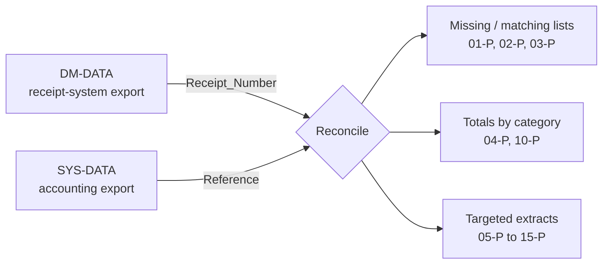

# Excel FILTER Function Examples

A practical, hands-on workbook and guide for Excel's dynamic-array functions — `FILTER`, `UNIQUE`, `XMATCH`, `SEARCH`, `SUMIFS` and friends — built around a realistic **receipt-vs-accounting reconciliation** scenario.

Fifteen worksheets, each a small self-contained lesson, plus a written guide that explains every formula: what it does, how it works step by step, and where it can go wrong.

> **Audience:** analysts, accountants and Excel power users who know basic formulas and want to move from `VLOOKUP` and manual filtering to dynamic arrays.

---

## What you will learn

| Skill | Functions used |
|---|---|
| Compare two lists (missing / matching items) | `VLOOKUP`, `ISNA`, `XMATCH`, `ISNUMBER` |
| Filter records by a *list* of values | `FILTER` + `XMATCH` |
| Remove duplicates and number results | `UNIQUE`, `ROWS` |
| Look up with **two** criteria | `SUMIFS`, `FILTER`, `INDEX`/`MATCH` with concatenated keys |
| Filter by text prefix or pattern | `FILTER` + `LEFT`, `MID`, `SEARCH` |
| Pick a category from a dropdown and list its records | `UNIQUE` + data validation + `FILTER` |
| "Contains" search (partial text) | `FILTER` + `ISNUMBER(SEARCH())` |
| Filter by day of month, with OR logic | `FILTER` + `TEXT` |
| Return only selected columns | nested `FILTER`, `CHOOSE({1,2},…)` |
| Reformat codes | `LEFT`/`MID`/`RIGHT`, `TEXTJOIN` with array constants |
| Show a formula as text inside the sheet | `FORMULATEXT` |

## Quick start

1. Download [`workbook/Filter_Function_Examples.xlsx`](workbook/Filter_Function_Examples.xlsx).
2. Open it in **Excel 365 or Excel 2021+** (see [requirements](#requirements)). The workbook recalculates when it opens.
3. Start with the two data sheets (`DM-DATA`, `SYS-DATA`), then work through `01-P` … `15-P` in order. Read the matching section of the [Formula Guide](docs/02-formula-guide.md) alongside each sheet.

## Workbook map

| Sheet | Topic | Key functions | Guide |
|---|---|---|---|
| `DM-DATA` | Source data: receipt-system export | — | [Data model](docs/01-data-model.md) |
| `SYS-DATA` | Source data: accounting-system export | — | [Data model](docs/01-data-model.md) |
| `01-P (1)`, `01-P (2)` | Find items present / missing between two lists | `VLOOKUP`, `ISNA`, `XMATCH` | [§01](docs/02-formula-guide.md#01-p--compare-two-lists) |
| `02-P Data Filter` | Filter records by a list of keys | `FILTER`, `XMATCH` | [§02](docs/02-formula-guide.md#02-p--filter-by-a-list-of-values) |
| `03-P Reports` | Unique lists with serial numbers | `UNIQUE`, `ROWS` | [§03](docs/02-formula-guide.md#03-p--unique-lists-with-serial-numbers) |
| `04-P` | Two-criteria lookup and totals | `UNIQUE`, `SUMIFS`, `FILTER`, `INDEX`/`MATCH` | [§04](docs/02-formula-guide.md#04-p--two-criteria-lookup) |
| `05-P`, `06-P` | Filter vouchers by prefix | `LEFT`, `FILTER`, `UNIQUE` | [§05](docs/02-formula-guide.md#05-p--06-p--filter-by-text-prefix) |
| `07-P` | Dropdown category → matching records | `UNIQUE`, `FILTER` | [§07](docs/02-formula-guide.md#07-p--category-dropdown-drives-a-filter) |
| `08-P` | Filter by a code inside the text | `MID`, `SEARCH`, `FILTER` | [§08](docs/02-formula-guide.md#08-p--filter-by-a-code-inside-the-text) |
| `09-P` | Reformat codes | `LEFT`, `MID`, `TEXTJOIN`, `FORMULATEXT` | [§09](docs/02-formula-guide.md#09-p--reformat-codes) |
| `10-P` | Unique combinations with totals | `UNIQUE`, `SUMIFS` | [§10](docs/02-formula-guide.md#10-p--unique-combinations-with-totals) |
| `11-P` | Filter by day of month | `FILTER`, `TEXT`, `SUBTOTAL` | [§11](docs/02-formula-guide.md#11-p--14-p--filter-by-day-of-month) |
| `12-P` | "Contains" search with a dropdown | `FILTER`, `SEARCH`, `IFERROR` | [§12](docs/02-formula-guide.md#12-p--contains-search) |
| `13-P` | Return only selected columns | nested `FILTER`, `CHOOSE` | [§13](docs/02-formula-guide.md#13-p--return-only-selected-columns) |
| `14-P` | Filter by two days (OR logic) | `FILTER`, `TEXT`, `SUBTOTAL` | [§14](docs/02-formula-guide.md#11-p--14-p--filter-by-day-of-month) |
| `15-P` | Search for a token inside receipt numbers | `FILTER`, `ISNUMBER`, `SEARCH` | [§15](docs/02-formula-guide.md#15-p--search-token-in-receipt-numbers) |

## The scenario

Two systems record the same transactions. The **receipt system** (`DM-DATA`) logs each receipt; the **accounting system** (`SYS-DATA`) posts a voucher for it. The shared key is the receipt number (`Receipt_Number` ↔ `Reference`). Reconciliation asks: *which receipts have no voucher, which vouchers have no receipt, and what do the totals look like by category, location or day?*



## Requirements

| Application | Support |
|---|---|
| Microsoft Excel 365 / Excel 2021 or later (Windows, Mac, web) | Full |
| Excel 2019 and earlier | **Not supported** — no `FILTER`, `UNIQUE` or `XMATCH` |
| Google Sheets | `FILTER`/`UNIQUE` exist, but `XMATCH` does not (use `MATCH`); not tested |
| LibreOffice | `FILTER`/`UNIQUE`/`XMATCH` arrive in 24.8; not tested |

More detail in [Pitfalls & compatibility](docs/03-pitfalls-and-compatibility.md).

## Repository layout

```
.
├── README.md
├── LICENSE
├── workbook/
│   └── Filter_Function_Examples.xlsx
└── docs/
    ├── 01-data-model.md                 # the two data sheets, column by column
    ├── 02-formula-guide.md              # every worksheet, every formula, explained
    └── 03-pitfalls-and-compatibility.md # errors, gotchas, best practices
```

## About the sample data

The data sheets contain **anonymized sample records**. Organization, branch and location names, receipt-number prefixes and bank-style reference codes were replaced with neutral placeholders (`City 01`, `Dept A`, `DEMO8-ER-…`, `DEMBB/R/…`, `ABC-DIT-…`). Structure, formats and formulas are preserved so the exercises behave like the real thing. Treat the figures as illustrative.

## Contributing

Issues and pull requests are welcome — corrections to explanations, additional worked examples, or Google Sheets / LibreOffice equivalents. When changing the workbook, keep formulas readable and update the matching section of the guide.

## License

Released under the [MIT License](LICENSE).
