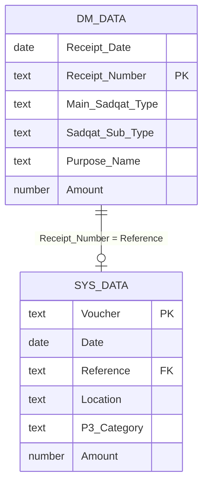

# Data Model

The workbook has two source sheets. Every lesson sheet (`01-P` … `15-P`) reads from them.

## `DM-DATA` — receipt-system export

One row per receipt. Headers are in **row 1**, data in **A2:I1292** (1,291 rows).

| Col | Header | Type | Example | Notes |
|---|---|---|---|---|
| A | `Receipt_Date` | date | `2023-03-10` | Used by the day-of-month filters (11-P, 14-P) |
| B | `Receipt_Number` | text | `DEMO8-ER-23-555` | Typical shape: `<prefix>-<channel>-<year>-<serial>` (`MB` receipts use a slightly different tail, e.g. `DEMO8-MB-ER23-877`). The **channel** (`ER`, `MB`, `DM`) is the second segment — see 08-P |
| C | `Main_Sadqat_Type` | text | `Sadqa` | Main category: `Sadqa`, `Wajiba`, `Ushr` |
| D | `Sadqat_Sub_Type` | text | `Zakat` | Sub-category within the main type |
| E | `Purpose_Name` | text | `For All` | |
| F | `Majlis_Name` | text | `DEPT A ` | Department. Values carry a **trailing space** (as in the original export) — see [pitfalls](03-pitfalls-and-compatibility.md#text-that-looks-equal-but-isnt) |
| G | `Location` | text | `City 01` | |
| H | `Amount` | number | `1500` | The column that `SUMIFS` and `SUBTOTAL` add up |
| I | `Currency_Name` | text | `PKR` | |

## `SYS-DATA` — accounting-system export

One row per posted voucher. Headers are in **row 7** (rows 1–6 are free for notes), data in **A8:H1298** (1,291 rows).

| Col | Header | Type | Example | Notes |
|---|---|---|---|---|
| A | `Voucher` | text | `DEMBB/R/23030000001` | Shape: `<prefix>/R/<number>`. Prefixes: `DEMBB`, `CB`, `ITD` — see 05-P |
| B | `Date` | date | `2023-03-10` | |
| C | `Reference` | text | `DEMO8-ER-23-1178` | **Join key** — matches `DM-DATA!Receipt_Number` |
| D | `Location` | text | `City 01` | Searched by 12-P |
| E | `Department` | text | `Dept A` | |
| F | `P-3` | text | `For All` | Category used by the 07-P dropdown |
| G | `Amount` | number | `1500` | |
| H | `Currency` | text | `PKR` | |

## How the sheets relate

The relationship is *zero-or-one*: a receipt may have no voucher yet, and the lesson sheets 01-P and 02-P show how to find out which.

## Conventions used in the lesson sheets

- **Row 2–3 of each lesson sheet** usually hold the *inputs* (a typed criterion, a dropdown, or a sample value).
- **Row 4/5** holds headers; the first formula sits directly below.
- A formula that returns many results is entered **once**, in the top-left cell. The results *spill* into the cells below and to the right. Do not type over a spill range — Excel will report `#SPILL!`.
- Where a sheet shows `FORMULATEXT(...)`, it is displaying the neighbouring formula as text so you can read it without selecting the cell.
